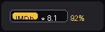

# IMDb ratings in Netflix with trailers

<sub>Current version: **0.8.0**</sub>

A small Chrome extension that puts IMDb ratings straight onto Netflix. It also shows Rotten Tomatoes and Metascore, so you can get a quick idea of a film or series without opening three extra tabs.

I made this for my own Netflix browsing and kept adding the bits I wanted to see.

## Supported services

| Service | Status |
| --- | --- |
| **Netflix** | ✅ Working and tested (title page, hover cards, rows, More Like This) |
| Disney+ | 🧪 Experimental, built without testing on a live account |
| Videoland | 🧪 Experimental, built without testing on a live account |
| NPO Plus / NPO Start | 🧪 Experimental, built without testing on a live account |
| Prime Video | 🧪 Experimental (Amazon already shows IMDb data on many pages) |
| Max / HBO Max, Apple TV, SkyShowtime, Paramount+, Hulu | 🧪 Experimental, untested |
| YouTube | ❌ Not supported: most videos are not films or series, so there is nothing reliable to match |

**Only Netflix is confirmed to work 100%.** The other services use a generic engine (`generic.js` + `sites.js`) that reads
the title from the page title, structured data, headings and poster text, and the type/year from the page when it is shown.
Their selectors are educated guesses based on each service's URL structure, so expect to need small fixes per service.
On poster rows without a year the extension is deliberately strict: it shows a score only when the match is unambiguous, otherwise nothing.
Turn on **debug** in the settings to see why a title was not matched, and add or adjust a service in `sites.js`.

## What it does

- Adds ratings to Netflix title cards, hover previews and the main title information page. It also scans the **More Like This** row and other similar-title rows as they appear while scrolling, including cards where Netflix places the title link and poster in separate elements.
- Shows a badge only when an IMDb rating is verified against a unique IMDb title ID. It leaves unmatched titles clean by default, with optional diagnostic badges available in debug mode.
- Lets you hover over a rating to see more: poster, plot, genre, director, cast, awards and box office.
- Can show the vote count next to the IMDb score.
- Offers three display styles: a full badge, compact text, or a minimal IMDb-only line.
- Lets you choose where ratings appear and whether badges shrink or disappear while a video is playing.
- Has a settings page where you can choose which scores to show, change badge size and enable debug information.
- Uses Netflix title metadata and exact IMDb title suggestions to avoid attaching a rating to a similarly named film or series. Ambiguous matches are left blank rather than guessed.
- Caches results locally, so it doesn't request the same rating every time you scroll past a title.
- Offers an optional trailer in the hover info card. It is off by default and only makes requests after a user adds a TMDb API key and enables the setting.

## A look at it


The badge pops in when a result arrives, and the loading indicator uses three softly pulsing dots. These small loops are animated previews of the effects used by the extension (they are illustrative UI previews, not recordings from a live Netflix session):




The corresponding CSS keyframes are in [badge.css](imdb%20in%20netflix/badge.css):

```css
@keyframes imdbPop {
  from { opacity: 0; transform: scale(.85); }
  to   { opacity: 1; transform: none; }
}

@keyframes imdbDot {
  0%, 80%, 100% { opacity: .3; transform: scale(.78); }
  40% { opacity: 1; transform: scale(1); }
}
```

GitHub does not execute the extension's CSS inside a README, so the GIF previews above show the motion while the code snippet documents the real CSS animation.

## Install it

This is currently a Chrome extension (Manifest V3).

1. Download this repository or clone it:

   ```bash
   git clone https://github.com/adminmossel/IMDb-in-Netflix.git
   ```

2. Open `chrome://extensions` in Chrome.
3. Turn on **Developer mode**.
4. Click **Load unpacked**.
5. Select the **imdb in netflix** folder inside the downloaded repository.
6. Open Netflix. The extension's settings page should open on first install.

## One-time setup: OMDb API key

The extension uses OMDb for rating details, so you need your own API key. This remains separate from the optional TMDb trailer key.

1. Get a free key at [omdbapi.com/apikey.aspx](https://www.omdbapi.com/apikey.aspx).
2. Choose the free plan and follow the activation link in the email.
3. Paste the key into the extension's settings page and click **Test and save**.

The free plan currently offers 1,000 requests per day. Found ratings are cached for 7 days; results without a rating are retried after 3 hours. The settings page has a built-in connection and title diagnostic if something isn't showing up.

## Optional trailers

Trailers are disabled by default. To enable them, create a TMDb API key at [the TMDb API settings page](https://www.themoviedb.org/settings/api), add it in the extension settings, test and save it, and switch on **Optional trailers**. The extension first tries to match the verified IMDb ID to TMDb, then checks title and year. If no safe match or YouTube trailer is found, no trailer is shown. Playback is embedded from YouTube when the user clicks the trailer preview.

## Settings

You can switch these on or off:

- Rotten Tomatoes score, Metascore and vote count
- Ratings on title cards and similar-title rows
- Ratings in hover previews and on the main title page
- The poster and details hover card

You can choose a full badge, compact text or a minimal IMDb-only line. There is also a small, medium or large size setting and a playback option: keep the badge normal, shrink it, or hide it while a video is playing. The settings page is available in English and Dutch.

## Device support

This version is a Chrome Manifest V3 extension for desktop browsers that support Chrome extensions. It does not run inside the Netflix app on a smart TV, Apple TV, console or phone. Chrome on phones does not support installing desktop extensions. An iPhone/iPad edition is technically possible through a separate Safari Web Extension app and packaging step; it is not included in this repository yet. For a TV, the practical workaround is to run Netflix in desktop Chrome on a computer connected to the TV.

## A note on missing ratings

Sometimes a title won't have a match. Netflix can use a localized title, while the rating database may list a different title. The extension tries several title sources and checks the release year and whether the result is a film or series. When Netflix does not provide enough information to safely distinguish two titles (for example, a film and series with the same name), it prefers showing no score rather than attaching the wrong one.

## Source

The extension code lives in [imdb in netflix/](imdb%20in%20netflix/). The main parts are:

- `content.js` — finds Netflix titles and places the badges.
- `background.js` — looks up ratings and manages the cache.
- `badge.js` and `badge.css` — build and style the badges and hover card.
- `options.html` and `options.js` — settings, API key setup and diagnostics.

Made by **adminmossel** in Meppel, The Netherlands.

[View the repository](https://github.com/adminmossel/IMDb-in-Netflix)


# Legal Notice

This software is an *independent project* and is not associated with, endorsed by, authorized by, or sponsored by Netflix, Inc. Netflix and all related names, trademarks, logos, and intellectual property are the property of their respective owners.

The software is designed exclusively for use with Netflix and is intended for lawful purposes only. Users are responsible for ensuring that their use of this software complies with all applicable laws, regulations, and platform policies.

The developer assumes no responsibility for misuse of this software or for any actions taken by users that violate applicable terms, policies, or laws. 

For questions or support, please contact: tygomassalt@gmail.com
